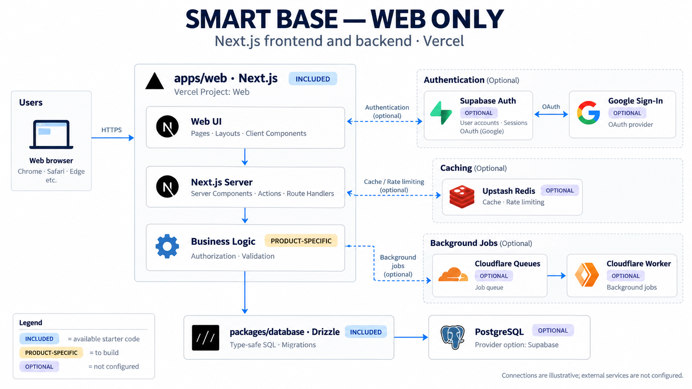
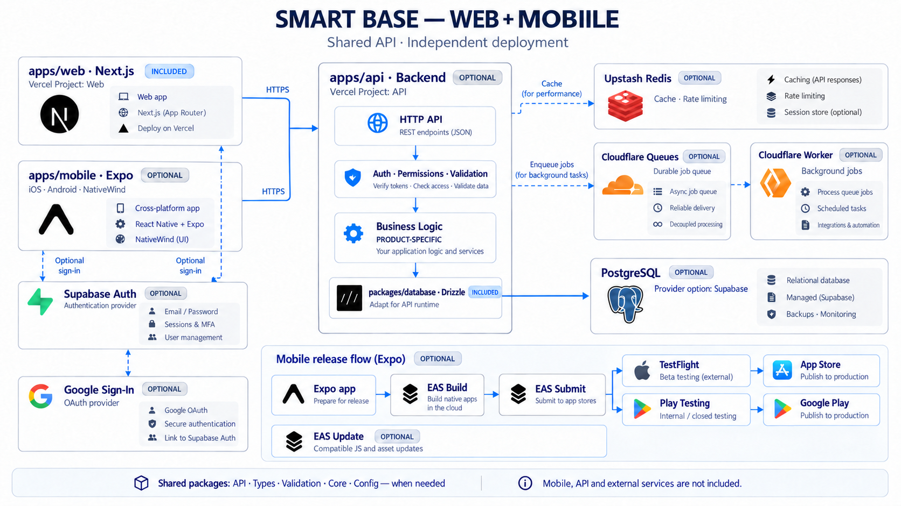

# Smart Base

A copyable Next.js starter for new applications. It includes a Feature-Sliced Design (FSD) structure, shared UI components, TanStack Query and Table, a schema-validated API client, a server-only AI text service, a lazy PostgreSQL/Drizzle package, and lint, typecheck, and test tooling. It contains no product logic from Smart Stock, Smart Idea, or Smart Shop.

## Architecture options

For a web-only product, keep the backend with the Next.js app:



For a product with web and mobile, prefer a separate backend shared by both apps:



These diagrams illustrate possible product architectures and data flows, not deployed connections. Smart Base currently includes the web app and database package; mobile, a separate API, product business logic, and external services are added when needed. The database package needs a compatible entry point and connection strategy for a separate API runtime. See the [architecture guide](templates/base/docs/architecture.md#choosing-a-backend).

## Create a product

Requires Node.js `>=22.22.2`, pnpm `10.32.1`, and network access to install dependencies. Run the published CLI from the directory where you want to create the project:

Version `0.1.0` has been submitted to npm and is still being processed; the command becomes usable when npm makes that version available.

```bash
npx create-smart-base@latest
```

To run the CLI from this repository instead:

```bash
pnpm install
pnpm create:app
```

The CLI first asks which platforms to include:

```text
What type of website do you want to build? Select one or more.
◻ Web
◻ Mobile
```

Use the arrow keys to navigate, **Space** to select one or both options, and **Enter** to confirm. Then enter a project name using lowercase letters, numbers, and hyphens, for example `my-app`.

| Selection      | What the CLI creates                                         |
| -------------- | ------------------------------------------------------------ |
| Web            | Next.js app and server-only database package.                |
| Mobile         | Expo Router app with NativeWind; no backend.                 |
| Web and Mobile | Next.js app, Expo app, and a minimal Hono API in `apps/api`. |

The project is created in a new directory under the current working directory. The CLI installs dependencies and formats the generated files; it refuses to overwrite an existing directory. If installation or formatting fails, run the indicated command again inside the generated directory.

To start the generated project:

```bash
cd my-app
pnpm dev          # Web when selected; otherwise Mobile
pnpm dev:mobile   # Mobile, when selected
pnpm dev:api      # API, when both Web and Mobile were selected
```

The API currently exposes only `GET /health`; it does not yet provide authentication, product routes, or database access. See the [CLI guide](docs/create-project.md) for packaging, mobile release, and further details.

To use the CLI from outside this checkout, build a local tarball and use its absolute path:

```bash
pnpm --filter create-smart-base pack
npx --yes --package=/absolute/path/to/create-smart-base-0.1.0.tgz create-smart-base
```

The published package is available at [npm: create-smart-base](https://www.npmjs.com/package/create-smart-base).

## Getting started

Requires Node.js `>=22.22.2` and pnpm `10.32.1` (pinned in `packageManager`).

```bash
pnpm install
pnpm dev
```

Open `http://localhost:3000`. No API key is required to run the app, build it, or run tests.

## Quality checks

```bash
pnpm format:check
pnpm lint
pnpm knip
pnpm typecheck
pnpm test
pnpm test:e2e
pnpm build
```

`pnpm test:e2e` runs a browser smoke test with Chromium and starts the app on port `3100`. If Chromium is not installed, run `pnpm --filter @smart-base/web exec playwright install chromium`.

`pnpm test` runs Vitest with coverage in `apps/web`, `packages/database`, and the `create-smart-base` CLI. Each workspace enforces 100% global line, statement, function, and branch coverage for its first-party runtime sources. See the [testing guide](templates/base/docs/testing.md) for the exact scope and exclusions.

## Deployment

Deploy the web app through Vercel Git integration and real background workers through worker-specific Cloudflare workflows. See the [deployment guide](templates/base/docs/deployment.md) and [worker guide](templates/base/apps/workers/README.md).

The [infrastructure guide](templates/base/infra/README.md) provides an empty Terraform structure and operating conventions for resources added by a product.

## Database

`@smart-base/database` creates a PostgreSQL connection only when `getDb()` is called. Add product tables under `packages/database/src/schema/`, generate and review migrations with `pnpm db:generate`, then apply them explicitly with `DATABASE_URL=... pnpm db:migrate`. See the [database guide](templates/base/docs/database.md).

## Building a product

For a new product, use the [product setup checklist](templates/base/docs/start-a-product.md) and [product brief template](templates/base/docs/product-brief.md) before starting the first workflow with an agent.

1. Read the [architecture guide](templates/base/docs/architecture.md) and identify the owning route, page, widget, feature, or entity.
2. Read the [Codex workflow](templates/base/docs/codex.md) and the [feature-development](templates/base/.agents/skills/feature-development/SKILL.md) skill.
3. Add the first domain model under `_entities`; do not add a placeholder domain to the starter.
4. Review [UI components](templates/base/docs/ui-components.md), [forms](templates/base/docs/forms.md), [API](templates/base/docs/api.md), [data fetching and tables](templates/base/docs/data-fetching-and-tables.md), [AI service](templates/base/docs/ai-service.md), [database](templates/base/docs/database.md), [mobile](templates/base/docs/mobile.md), [observability](templates/base/docs/observability.md), and [testing](templates/base/docs/testing.md) before adding the corresponding layer.
5. Put independent background workloads under [`apps/workers/`](templates/base/apps/workers/README.md); add a worker package only when the application has a defined workload.

## Repository structure

The CLI lives separately from its source templates. In this repository, `pnpm dev` runs the web template; use the CLI to create a separate product before adding product-specific code.

```text
packages/create-smart-base/  # CLI
templates/base/             # Web, database, migrations, infrastructure, and .env.example
templates/mobile/           # Expo app template
templates/mobile-root/      # Mobile-only workspace template
templates/api/              # Minimal API template
```

Product-specific root configuration, including `.env.example`, package scripts, workspace membership, and Git, Prettier, and Knip settings, lives in `templates/base/`. The CLI copies these files into each generated Web product. Root workspace, TypeScript, Turbo, formatting, CI, and agent configuration also support development of this repository; settings that apply equally to a product are shared when packaging.

The following shows a generated Web product alongside the source-only CLI. In this repository the Web product files below live under `templates/base/`.

## Structure

```text
apps/
├── web/                    # Next.js app with FSD layers under src/
└── workers/                # Workspace convention; no worker package exists yet
packages/
├── database/               # Shared server-only PostgreSQL/Drizzle infrastructure
└── create-smart-base/      # CLI and opt-in product templates
drizzle/                    # Migration output; no generated migrations exist yet
```

The CLI is a tool for creating products; it is not copied into generated products. There are no additional product-shared packages or worker jobs in the starter. Add them only for a real consumer or workload.

The current FSD slices live under `apps/web/src/`. The starter includes `app/`, `_app/`, `_entities/ai/`, and `_shared/`; create `_pages/`, `_widgets/`, and `_features/` only when a product needs them. The dependency direction is:

```text
app → _app → _pages → _widgets → _features → _entities → _shared
```

ESLint checks import direction between layers. See [architecture.md](templates/base/docs/architecture.md) for boundaries and examples.

See [worker guidance](templates/base/apps/workers/README.md) for worker placement and [package guidance](templates/base/packages/README.md) for shared-package ownership.

## Codex

`AGENTS.md` is the agent entry point. `.codex/` contains workflow guidance and the starter's current state; `templates/base/.agents/skills/feature-development/` describes the feature-development process for generated Web products. Model, approval, and sandbox settings remain user-managed.
